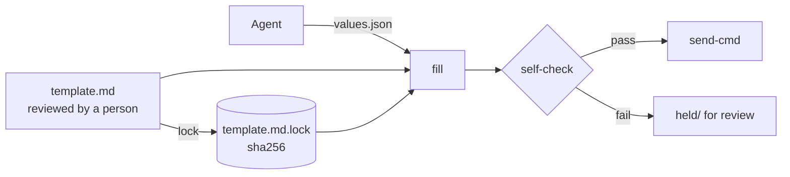

# locked-digest

Let an AI agent fill in a report without letting it rewrite the report.

Agents are good at gathering the facts for a daily digest and bad at keeping its
format, wording and disclaimers the same every day. locked-digest separates the
two: a reviewed markdown **template is locked** (by SHA-256), the agent supplies
only **typed values** (JSON), and every filled digest goes through a
**self-check** before anything is sent. If the check fails, the digest is held
for a person to review instead of going out.



## What the self-check enforces

- **Locked text is byte-identical.** The checker builds a strict regex from the
  template. Edited headings, removed disclaimers, extra or missing lines fail.
- **Typed slots.** `date`, `int`, `number`, `enum(...)`, single-line `text` and
  `list`, each with a length cap. Newlines inside a value are collapsed, and
  braces are refused, so a value can't add sections or new slots.
- **Deny patterns.** Email addresses, long digit runs (account, card or phone
  numbers; ISO dates are allowed), IPv4 addresses, common token prefixes,
  private-key headers and home-directory paths hold the digest.
- **Cross-field rules.** For example `on_time <= total`.
- **Template drift.** If the template changes after it was locked, `fill`,
  `check` and `send` refuse to run until someone reviews and re-locks it.

## Quick start

```bash
git clone https://github.com/globe-teck/locked-digest
cd locked-digest
python3 -m locked_digest lock examples/daily-digest.md
python3 -m locked_digest send examples/daily-digest.md \
  --values examples/values.json --rules examples/rules.json \
  --send-cmd ./examples/send-stdout.sh
```

The template (`examples/daily-digest.md`):

```markdown
# Daily operations digest: {{date:date}}

Overall status: **{{overall:enum(green,yellow,red)}}**

## Finished today
{{done:list:max=160}}

## Scheduled routines
- On time: {{on_time:int}} of {{total:int}}
- Notes: {{routine_notes:text:max=200}}
```

The values the agent writes (`examples/values.json`, made-up data):

```json
{"date": "2026-03-05", "overall": "yellow",
 "done": ["Weekly report published", "Backup restore test passed"],
 "decisions": [], "on_time": 11, "total": 12,
 "routine_notes": "nightly-backup missed its 02:15 run; rerun at 08:40 succeeded"}
```

An empty list renders as `- none`. If a value slipped in an email address, `send` holds it:

```text
HOLD deny: email address on line 14
not sent; kept for review at held/digest-held.md
```

## Commands

| Command | What it does | Exit codes |
|---------|--------------|------------|
| `lock TEMPLATE` | Writes `TEMPLATE.lock` with the template's SHA-256 and slot names. Run it after a person reviews the template. | 0 |
| `fill TEMPLATE --values V [--out F]` | Fills and self-checks; prints or writes the digest. | 0 pass, 3 held, 1 error |
| `check TEMPLATE DIGEST` | Self-checks a digest file, for example one an agent edited by hand. | 0 pass, 3 held, 1 error |
| `send TEMPLATE --values V --send-cmd CMD` | Fills, self-checks and pipes the digest to `CMD` on stdin (no shell). On failure, writes `held/digest-held.md` and sends nothing. | 0 sent, 3 held, 1 error |

Common options: `--rules rules.json` (a list of `[field, op, field]`, with op
one of `<= < == >= >`) and `--max-chars` (default 8000).

## Slot reference

`{{name:type}}` or `{{name:type:max=N}}`. Names are lowercase
`[a-z][a-z0-9_]*`, and each name appears once.

| Type | Accepts | Rendered as |
|------|---------|-------------|
| `text` | one line, max 200 chars by default | the text |
| `int` / `number` | JSON integer / number | digits |
| `date` | `YYYY-MM-DD` | the date |
| `enum(a,b,c)` | one of the listed words | the word |
| `list` | JSON list of short strings (max 50 items); must start a line | `- item` lines, or `- none` |

## Limits

- The self-check proves the digest has the locked shape and passes the deny
  list. It cannot tell whether the facts in the values are true; keep a person
  or a second check on anything that matters.
- The deny list is pattern-based. Add your own patterns (project code names,
  client names) for your data; see `locked_digest.check.DEFAULT_DENY`.

## Tests

```bash
python3 -m pip install pytest
python3 -m pytest -v
```

43 offline tests cover slot types and limits, structure-injection attempts,
locked-text edits, template drift, the deny patterns, cross-field rules and the
CLI exit codes (sent, held, error). CI runs them on Ubuntu and macOS with Python
3.10 and 3.12, runs the example end to end, and runs `shellcheck`.

## Authorship

Leigh Rodney, AI Researcher & Founder at Globe Teck (Python: basic). Built with
AI coding assistance. I defined the requirements, ran the tests, and reviewed
the changes.

## License

MIT. See [LICENSE](LICENSE).
